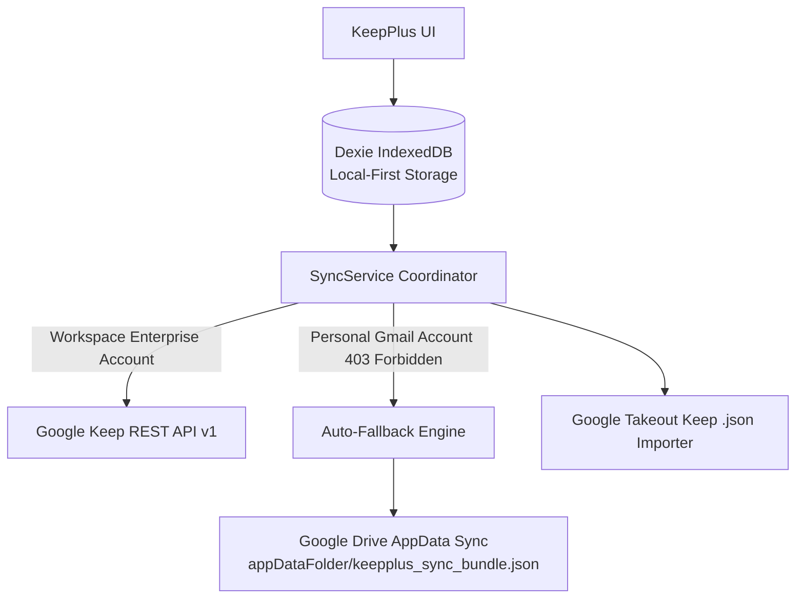

# ⚡ KeepPlus — Setup & Architecture Guide

KeepPlus is a local-first, keyboard-centric web application that upgrades Google Keep with live Markdown rendering, nested drag-and-drop checklists, bi-directional WikiLinks (`[[Note Title]]`), Kanban boards, and dual-tier Google synchronization.

---

## 1. Quick Start

### Running Locally
```bash
# 1. Install dependencies (already pre-installed)
npm install

# 2. Run the development server
npm run dev

# 3. Open http://localhost:3000 in your browser
```

KeepPlus works **instantly out-of-the-box in Local-First Mode** with IndexedDB (Dexie.js). You do not need to configure Google credentials to use the app, test markdown, organize notes by Kanban/Tags, or import Takeout archives.

---

## 2. Google Cloud Console OAuth Setup

To synchronize notes with your Google account, configure Google OAuth 2.0:

### Step 1: Create a Project in Google Cloud Console
1. Go to the [Google Cloud Console](https://console.cloud.google.com/).
2. Click **Select a project** > **New Project**, name it `KeepPlus`, and click **Create**.

### Step 2: Enable the APIs
1. Navigate to **APIs & Services** > **Library**.
2. Search for and enable:
   - **Google Drive API** (used for consumer `appDataFolder` fallback sync)
   - **Google Keep API** (used for official Enterprise note sync)

### Step 3: Configure OAuth Consent Screen
1. Go to **APIs & Services** > **OAuth consent screen**.
2. Select **External** (or **Internal** if using a Google Workspace organization) and click **Create**.
3. Fill in:
   - **App name**: `KeepPlus`
   - **User support email**: your email
   - **Developer contact information**: your email
4. On the **Scopes** step, click **Add or Remove Scopes** and add:
   - `.../auth/userinfo.profile`
   - `.../auth/userinfo.email`
   - `https://www.googleapis.com/auth/drive.appdata` (Enable the Google Drive API in Library first)

> [!NOTE] Why isn't `https://www.googleapis.com/auth/keep` available in Google Cloud Console?
> Google officially restricts the Google Keep API exclusively to Google Workspace Enterprise domains. It **cannot be selected or authorized on standard personal `@gmail.com` accounts or non-Enterprise Cloud projects**.
> 
> KeepPlus is specifically architected to handle this: **you only need `drive.appdata`**. KeepPlus automatically synchronizes your notes into your private, hidden Google Drive `appDataFolder` without requiring the Enterprise Keep scope.
> 
> *(Only add `https://www.googleapis.com/auth/keep` if your project belongs to a verified Google Workspace Enterprise organization and you set `ENABLE_KEEP_ENTERPRISE_SCOPE=true` in `.env.local`)*.

### Step 4: Create OAuth 2.0 Client Credentials
1. Go to **APIs & Services** > **Credentials**.
2. Click **Create Credentials** > **OAuth client ID**.
3. Set **Application type**: `Web application`.
4. Name: `KeepPlus Web Client`.
5. Under **Authorized JavaScript origins**, add:
   - `http://localhost:3000`
6. Under **Authorized redirect URIs**, add:
   - `http://localhost:3000/api/auth/callback/google`
7. Click **Create** and copy your **Client ID** and **Client Secret**.

### Step 5: Add Credentials to `.env.local`
Open `.env.local` in the project root and populate:
```env
NEXTAUTH_URL=http://localhost:3000
NEXTAUTH_SECRET=a-secure-random-32-character-secret-key-123456

GOOGLE_CLIENT_ID=your-client-id.apps.googleusercontent.com
GOOGLE_CLIENT_SECRET=GOCSPX-your-client-secret
```

---

## 3. Modular Sync Engine Architecture

The Google Keep REST API is officially restricted to Google Workspace Enterprise domains. KeepPlus solves this restriction with a dual-adapter engine:



1. **Google Keep API Adapter:** Maps local notes to Keep v1 endpoints (`notes.create`, `notes.list`, `notes.patch`, `notes.delete`), preserving titles, markdown text, checklists (`ListItem`), and labels.
2. **Google Drive AppData Fallback Adapter:** Automatically triggers when an HTTP 403 occurs on personal accounts. Saves structured JSON bundles in the hidden `appDataFolder` where users cannot accidentally modify or delete them.
3. **Google Takeout Importer:** 1-click drag-and-drop or sample importer for exported Keep JSON files from `takeout.google.com`.

---

## 4. Key Usability Upgrades

| Feature | Description | Shortcut |
|---|---|---|
| **Global Command Palette** | Fuzzy search notes, tasks, commands, tags | `Cmd + K` / `Ctrl + K` |
| **New Note** | Quickly create a new markdown note | `C` |
| **New Checklist** | Open an interactive task list | `L` |
| **Focus Search** | Move focus to global search input | `/` |
| **Masonry Grid View** | Classic Google Keep sticky-note layout | `Cmd + 1` |
| **Kanban Board View** | Tag-based columns (`#todo`, `#doing`, `#done`) | `Cmd + 2` |
| **Focus List View** | Split-pane distraction-free writing environment | `Cmd + 3` |
| **Bi-directional Links** | WikiLinks autocomplete & backlinks footer | `[[` |
| **Nestable Checkboxes** | Indent/outdent checklists (levels 0-2) | `Tab` / `Shift+Tab` |
| **Save & Close** | Commit and close active note editor | `Cmd + Enter` |
| **Help Sheet** | Show interactive keyboard shortcuts modal | `?` |

---

## 5. Technology Stack

- **Framework:** Next.js (App Router), React 19, TypeScript
- **Styling:** Tailwind CSS, Lucide Icons, Custom Typography
- **Local Storage:** Dexie.js (IndexedDB wrapper with reactive `useLiveQuery`)
- **Authentication:** NextAuth.js (Auth.js) with Google OAuth 2.0
- **Markdown & Code:** `react-markdown`, `remark-gfm`
